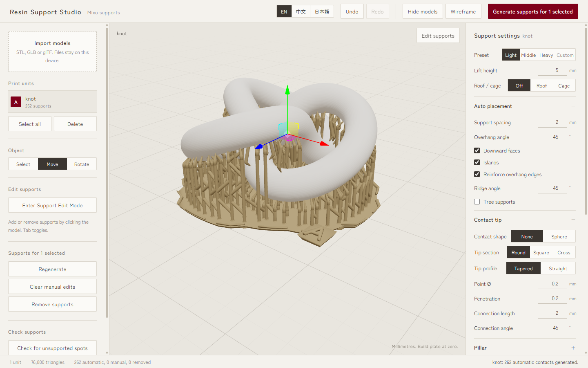
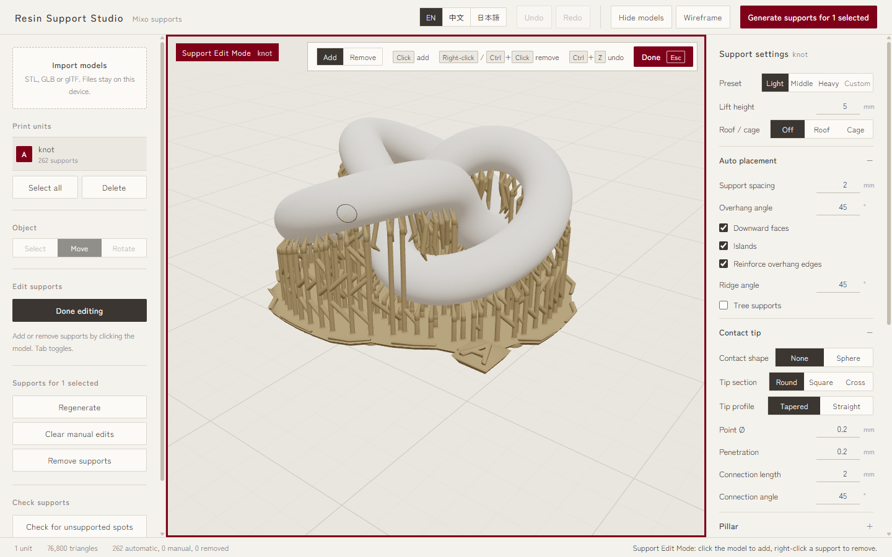
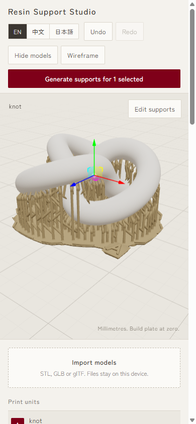
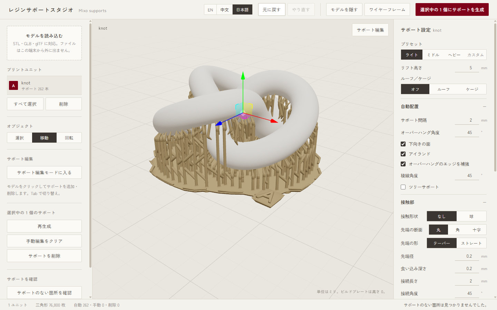

<div align="center">

# Mixo Supports

**Free resin 3D-print supports, made in your browser.**
Drop in a model, get print-ready SLA / MSLA / DLP supports in seconds, fine-tune them by hand, and export an STL for your slicer. Nothing to install and no account needed. Your files never leave your computer.

### [▶ Open Mixo Supports](https://mixocreative.github.io/mixo-supports/)

English · 中文 (繁體) · 日本語



</div>

---

## Why Mixo Supports

- **Works anywhere.** It runs in the browser on Windows, macOS, Linux, ChromeOS, tablets and phones. Open the link and start.
- **Private by design.** Models are read and processed on your device. Nothing is uploaded, and there is no sign-up and no analytics.
- **Proven geometry.** The support generator matches the Blender SLASG / Resin UV support system, and is checked against real Blender output down to the bit.
- **Fast on big models.** Heavy work runs in background workers, so the editor stays smooth, and every long task shows a progress bar.
- **Free.** No watermark and no paywalled features.

## Features

### Automatic supports
- One click places supports on **downward faces**, **islands** (lowest points that would print in mid-air) and **overhang edges**.
- **Light, Middle and Heavy presets**, or full custom control of spacing, overhang angle, ridge angle, lift height, pillar diameter and more.
- **Tree supports** that branch and merge to save resin and peel force.
- A **raft** that follows the model outline, with flared walls and a unit letter. **Roof** and **Cage** modes are also available.
- Several models on one plate. Each model is its own print unit with supports that move and rotate with it.

### Contact tips that print well and snap off clean
- **Cone point by default**: a 0.2 mm tip that widens to the pillar, so contact marks stay small.
- Tip section can be **Round**, **Square** or **Cross**, and the profile **Tapered** or **Straight**. Contact shape is **None** or **Sphere**.
- Adjustable **penetration**, so tips sink into the model and fuse during the print instead of letting go.

### Support Edit Mode


- Enter the mode, then **click** to add a support or **right-click** to remove one. A ghost preview shows what will happen before you click.
- A red frame and badge make it obvious you are editing. Press **Done** or **Esc** to leave, and Tab toggles the mode.
- Full **undo / redo**. Manual edits survive regeneration, and **Clear manual edits** puts everything back to automatic.

### Check for unsupported spots
Scans the model for islands and overhangs that no support reaches and lists each one. **Show** flies the camera to the spot, and **Fix** opens Support Edit Mode there so you can add what is missing.

### Import and export
- Import **STL**, **GLB** and **glTF**. STL is read Z-up, the same as your slicer.
- Export **STL**: the active unit or each unit, with or without the model, or the whole plate in one file.
- The exported file loads straight into Chitubox, Lychee, PrusaSlicer, UVtools and other resin slicers.

### Phone, tablet and three languages

| Phone | 日本語 |
|---|---|
|  |  |

The interface picks up your browser language and remembers your choice. Switch between **English**, **繁體中文** and **日本語** at any time.

## How to use it

1. Open **[mixocreative.github.io/mixo-supports](https://mixocreative.github.io/mixo-supports/)**.
2. Drop your STL, GLB or glTF onto **Import models**.
3. Move or rotate the model into print orientation.
4. Press **Generate supports**, then pick a preset or tune the settings.
5. Optional: run **Check for unsupported spots**, or fix things by hand in **Support Edit Mode**.
6. **Export** an STL and slice it as usual.

## For developers

React, Three.js (react-three-fiber), TypeScript, Vite and Web Workers, with three-mesh-bvh for picking.

```bash
npm install
npm run dev      # local editor at http://localhost:5173/mixo-supports/
npm test         # Vitest suite, including the Blender parity tests
npm run build    # type-check and production build into dist/
```

Every push to `main` is deployed to GitHub Pages.

| Path | What lives there |
|---|---|
| `src/supports/` | Settings and presets, support mesh, tree topology, raft, STL export |
| `src/analysis/` | Placement (downward faces, islands, edges), Blender BVH and normals ports, support check |
| `src/workers/` | Mesh (preview and export), analysis pool and import workers, each with a typed client |
| `src/components/` | Viewport, settings panel, progress bar |
| `tools/blender-parity/` | Headless Blender scripts that record the reference data the tests compare against |
| `docs/` | Design notes: [Blender parity](docs/BLENDER_PARITY.md), [SLASG node logic](docs/SLASG_NODE_LOGIC.md), [handoff](docs/HANDOFF.md) |

## Feedback

Found a model that supports badly, or want a feature? [Open an issue](https://github.com/mixocreative/mixo-supports/issues) and attach the file if you can. A ⭐ helps other resin printers find the project.

---

<sub>Keywords: resin 3D printing, SLA supports, MSLA, DLP, LCD resin printer, auto supports, tree supports, support generator, STL support editor, free Chitubox and Lychee alternative, browser 3D print prep, Elegoo, Anycubic, Phrozen, Formlabs, miniatures, tabletop, jewelry.</sub>
