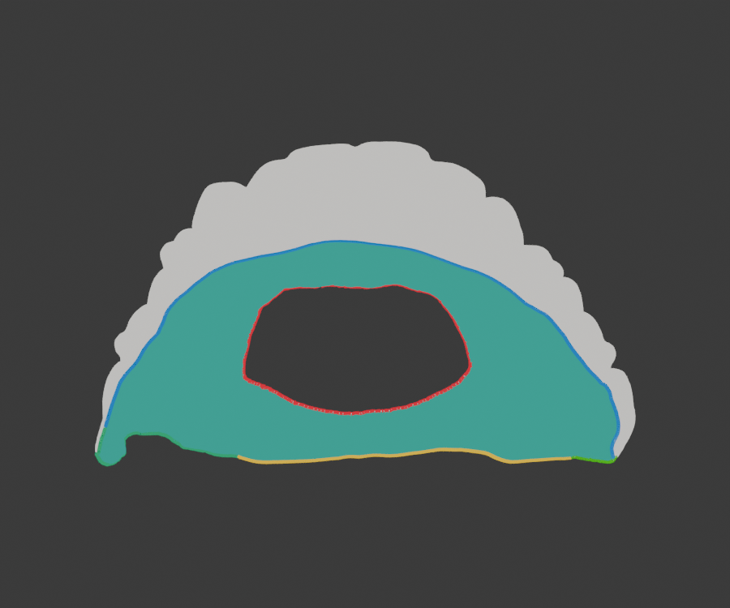
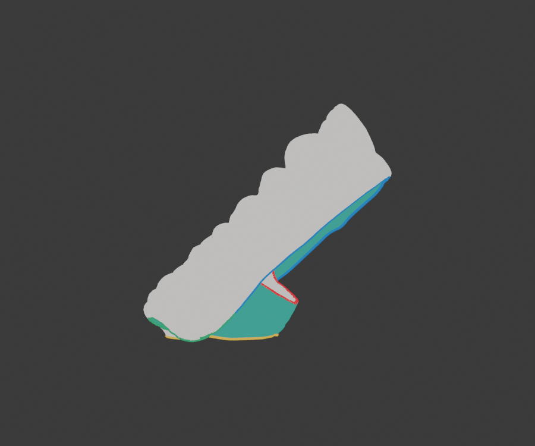

# Review model: proposed outer ridge, opening, and support faces

Open `support-area-review.glb` and rotate the model. This is the **reference-STL candidate for operator review**, not the production mask and not a claim that supports are safe.

- **Blue:** long sharp outer-ridge section detected at 60°.
- **Yellow:** shorter sharp outer-ridge section detected at 60°.
- **Green:** two 20° sharp-network paths joining those sections. The longer one must be checked carefully at the posterior end.
- **Red:** central-opening silhouette lifted to a 339-edge mesh loop.
- **Teal faces:** the proposed support-contact surface enclosed by the two contours. Only these faces would be considered for tips if the method passes further tests.
- **Neutral off-white faces:** everything else, proposed as forbidden for tips.





On this neutral reference, the two loops separate 254,344 teal faces from 119,612 neutral faces. The partition is unchanged under three large input rotations of this same STL. That does **not** establish reliability on a different patient's aligner or prove every teal face is anatomically safe. The operator should check whether all teal faces—and no off-white faces—match the intended contact zone, especially both back ends and the green joins.

Regenerate with PowerShell:

```powershell
$env:DENTAL_PROBE_FIXTURE='docs/dental-reference/reference-aligner.stl'
$env:DENTAL_PROBE_CONNECTORS='1'
$env:DENTAL_PROBE_OPENING='1'
$env:DENTAL_PROBE_REVIEW_GLB='docs/dental-reference/support-area-review.glb'
.\node_modules\.bin\vite-node.cmd scripts/probe-dental-edges.ts
```
