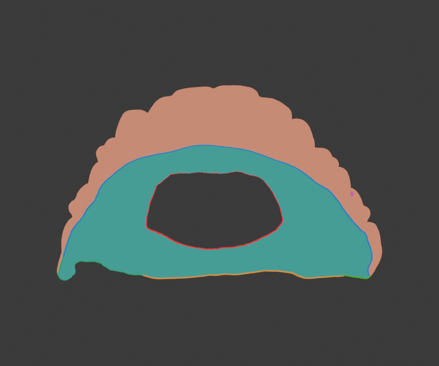
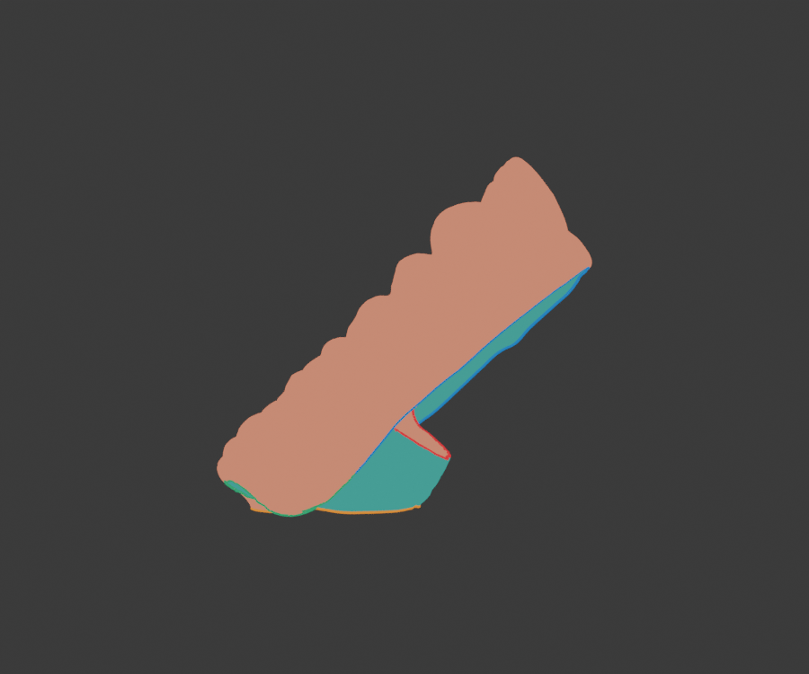

# Two-contour surface partition — diagnostic, not support permission

The operator's [annotated view](07-outer-ridge-and-inner-opening-annotation.png) identifies a sharp **outer/down-facing ridge** (blue and orange measured sections, green missing sections) and the central opening (red). This reference-only probe tests that topological idea.

Open `two-contour-face-regions.glb`: **blue/orange/green** make the candidate outer ridge, **red** is a candidate mesh loop around the projected central opening. **Teal** and **coral** are the two resulting face-connected regions, deliberately named *unclassified* in the GLB. Teal appears broadly on the intended underside in the rendered views; coral appears predominantly on tooth/exterior surfaces. Neither has been approved for support tips.





## Measured on this one reference STL

- Projected mesh occupancy has exactly one enclosed central hole at 256, 384, and 512-pixel grids. At all three sizes the same 342 silhouette edges near the hole are selected: a 339-edge main loop plus a spurious 3-edge loop sharing one vertex.
- The candidate outer contour is a simple 2,665-edge cycle. Together with the 339-edge opening loop, blocking face adjacency splits the 373,956-face mesh into **254,344-face** and **119,612-face** regions.
- The 254,344-face region has mean normal·opening **+0.381**; the 119,612-face region has **−0.299**. This sign is geometric evidence, not anatomical ground truth.
- The probe was repeated after input rotations of `[1.1, −2.2, 0.7]`, `[−2.5, 0.4, 2.1]`, and `[0.9, 1.7, −1.3]` radians, in addition to the original pose. All four yielded the same 339-edge opening loop, connector lengths (10.55 and 40.39 mm), two regions, and face counts. This shows rotation consistency on **one mesh**, not generalization to other aligners.

## Remaining gate

The operator must compare teal/coral and both green joins against the intended anatomy, especially at the posterior ends. Then test at least one distinct similar STL, local perturbations, forbidden-face labels, brush edits, and final landed tips. Until those checks pass, the production dental mask remains fail-closed and no automatic contacts are authorized by this probe.

Reproduce the GLB with PowerShell:

```powershell
$env:DENTAL_PROBE_FIXTURE='docs/dental-reference/reference-aligner.stl'
$env:DENTAL_PROBE_CONNECTORS='1'
$env:DENTAL_PROBE_OPENING='1'
$env:DENTAL_PROBE_REGION_GLB='docs/dental-reference/two-contour-face-regions.glb'
.\node_modules\.bin\vite-node.cmd scripts/probe-dental-edges.ts
```
